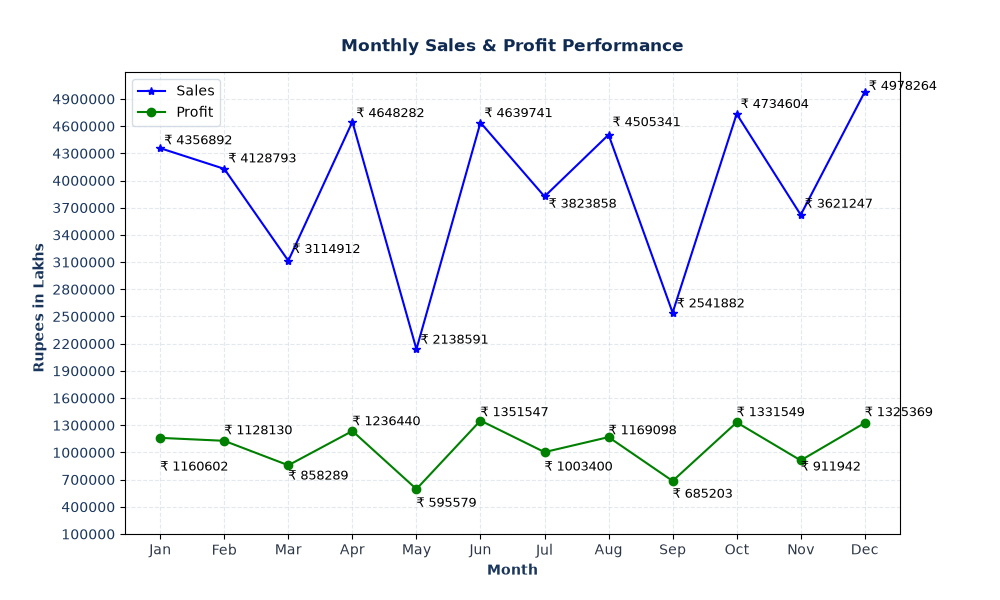
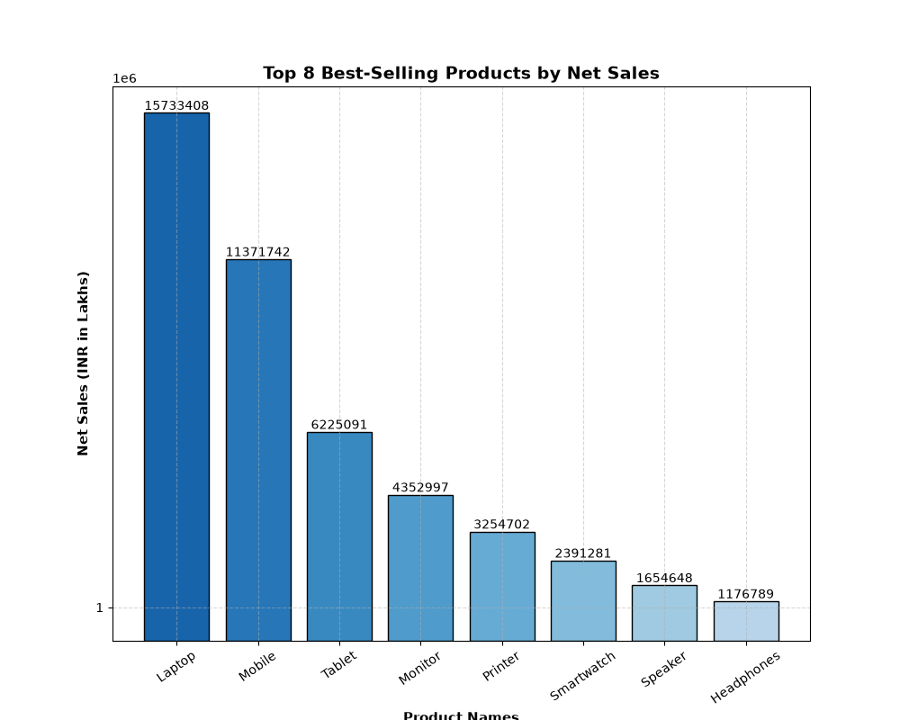
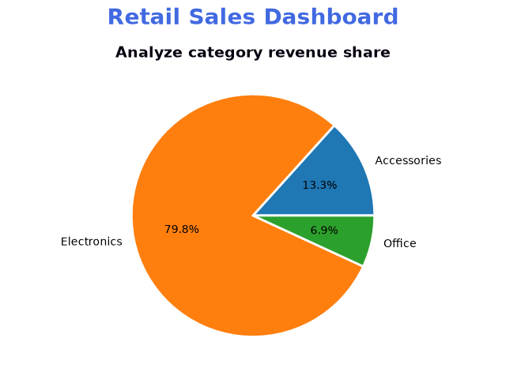
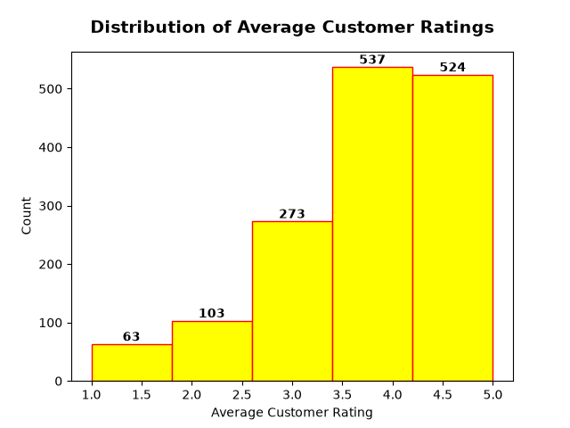
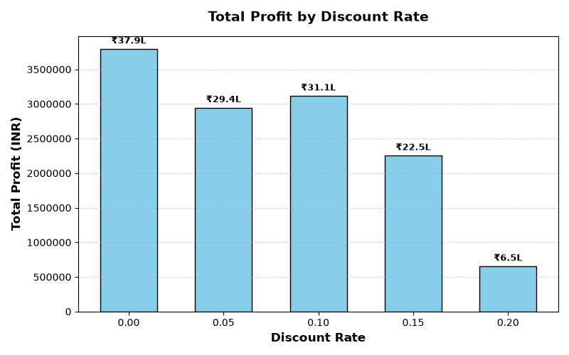
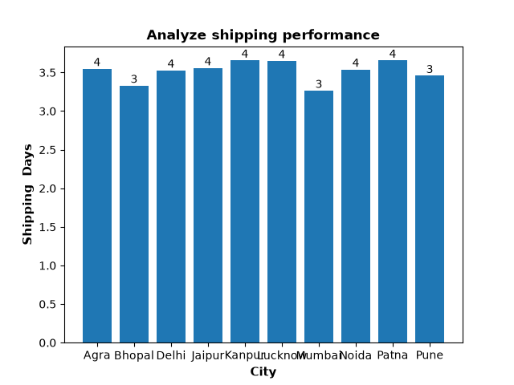
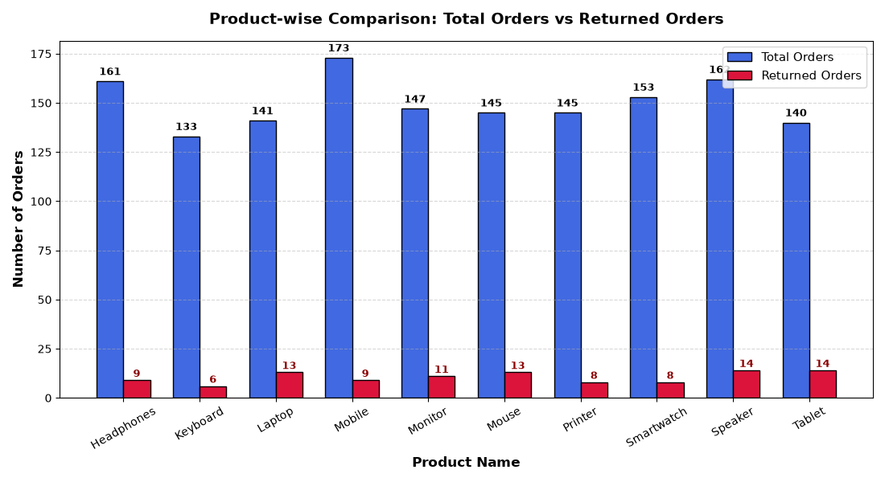
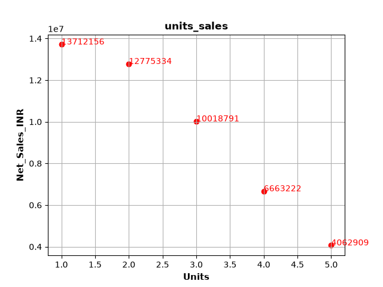
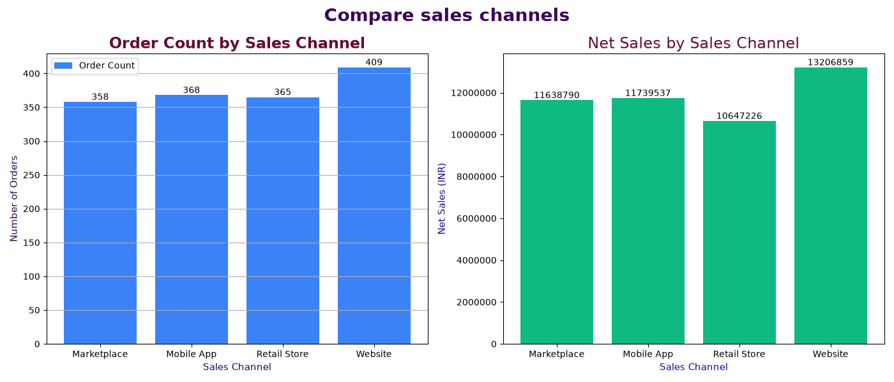
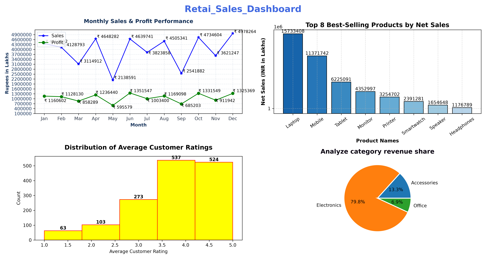

# Comprehensive Retail Sales & Visual Performance Analysis Report

**Project Title:** Multi-Dimensional Retail Sales & Operational Performance Analysis  
**Prepared By:** Devansh Mishra                                                                                                                          

**Dataset Scope:** 1,500 Orders | Multi-Channel Distribution | Comprehensive Visual Portfolio  

---

## Executive Summary
This study evaluates end-to-end retail sales records across 1,500 orders to extract performance patterns across timelines, regional territories, product catalogs, distribution channels, and logistics workflows.
* **Gross Portfolio Net Sales:** INR 4,72,32,411.65 (~INR 4.72 Cr)
* **Cumulative Operating Profit:** INR 1,27,57,153.91 (~INR 1.28 Cr)
* **Portfolio Net Profit Margin:** 41.51%
* **Aggregate Volume:** 2,667 Units across 1,500 orders (~1.78 units/order)
* **Average Customer Rating:** 3.90 / 5.00
* **Total Returns Recorded:** 105 Orders (7.00% Overall Return Rate)

---

## 1. Visual Portfolio & Empirical Insights

### Visual 1: Monthly Sales & Profit Trajectory (Dual-Line Chart)

* **Visual Mapping:** Tracks monthly Net Sales and Operating Profit across all 12 calendar months using dual line plots with marker annotations.
* **Core Takeaway:** Revenue peaks sharply during June (INR 46.40L Net Sales | INR 13.52L Profit) and December (INR 49.78L Net Sales | INR 13.25L Profit). An acute contraction occurs in May (INR 21.39L Net Sales | INR 5.96L Profit), revealing clear mid-year seasonality.

---

### Visual 2: Product Performance Hierarchy (Vertical Bar Chart)

* **Visual Mapping:** Displays top-performing product lines sorted descending by Net Sales volume with direct value labels.
* **Core Takeaway:** Laptop dominates overall portfolio revenue at INR 1,57,33,407.50 (INR 40.22L Profit | 257 units), followed by Mobile at INR 1,13,71,742.20 (INR 32.49L Profit | 312 units). Together, these two categories generate over 57% of total revenue.

---

### Visual 3: Geographic Revenue Distribution (Horizontal Bar Chart)

* **Visual Mapping:** Compares total Net Sales, profit contribution, and transaction volume across all operational regional hubs.
* **Core Takeaway:** Mumbai ranks first across all territories with INR 65,83,396.30 in Net Sales and INR 16,57,670.12 in profit across 162 orders. Secondary high-performing markets include Agra (INR 53.62L) and Patna (INR 51.31L).

---

### Visual 4: Category Revenue Contribution (Proportional Pie Chart)

* **Visual Mapping:** Segmented pie chart detailing proportional market share across core product categories with clean edge separators.
* **Core Takeaway:** Electronics holds a dominant 79.8% share of aggregate retail revenue (INR 3.77 Cr). Accessories accounts for 13.3% (INR 62.94L), while Office supplies contributes the remaining 6.9% (INR 32.55L).

---

### Visual 5: Customer Satisfaction Distribution (Binned Histogram)

* **Visual Mapping:** Binned histogram tracking frequency distributions of customer satisfaction ratings across 5 uniform intervals.
* **Core Takeaway:** Scores cluster predominantly between 3.5 and 4.2 stars. While customer perception remains stable overall, ratings above 4.5 remain underrepresented, pointing to fulfillment service gaps.

---

### Visual 6: Discount Rate vs. Total Profitability (Bar Chart)

* **Visual Mapping:** Evaluates aggregate net profit and revenue yields across discrete discount brackets (0% to 20%).
* **Core Takeaway:** A 0.00% discount rate yields the highest aggregate profit at INR 37,93,019.42. Progressively steeper discounting rapidly degrades margins without driving sufficient volume compensation.

---

### Visual 7: City & Channel Fulfillment Duration (Bar Chart)

* **Visual Mapping:** Measures average delivery transit times (Shipping Days) segmented across destination cities.
* **Core Takeaway:** Mumbai maintains the most efficient fulfillment network at 3.27 days. Conversely, Kanpur (3.66 days), Patna (3.66 days), and Lucknow (3.65 days) lag behind.

---

### Visual 8: Order Return Dynamics & SKU Exposure (Segmented Summary Chart)

* **Visual Mapping:** Contrasts non-returned orders against return volumes and isolates return frequencies across individual product types.
* **Core Takeaway:** Returns represent INR 38,20,934.15 in reverse-logistics value across 105 orders. The highest absolute return counts occur in Tablet (14 orders), Speaker (14 orders), and Laptop (13 orders).

---

### Visual 9: Order Quantity vs. Revenue Interaction (Scatter Plot & Correlation)

* **Visual Mapping:** Scatter plot mapping Units Sold against transactional Net Sales, backed by parametric correlation matrices.
* **Core Takeaway:** Transactional revenue is primarily driven by unit price rather than high basket unit counts alone. High-ticket purchases stay concentrated within 1-2 unit order volumes.

---

### Visual 10: Sales Channel Revenue Comparison (Bar Chart)

* **Visual Mapping:** Compares total Net Sales and order volumes across proprietary (Website, Mobile App) and external sales channels.
* **Core Takeaway:** Proprietary digital platforms outperform external channels, with **Website** generating **INR 1,32,06,859.25** across 409 orders, followed closely by **Mobile App** (INR 1,17,39,537.35). External marketplaces and retail stores trail behind.

---

## 2. Integrated Analytical Dashboard

*(Top-Left: Monthly Sales & Profit Trajectory | Top-Right: Top 8 Product Revenue Rankings | Bottom-Left: Customer Rating Frequency Distribution | Bottom-Right: Category Market Share Breakdown)*

---

## 3. Evidence-Based Strategic Recommendations

### 1. Catalog Capitalization on Core Revenue Drivers
* **Evidence:** Laptop (₹1.57 Cr) and Mobile (₹1.14 Cr) account for over 57% of total revenue.
* **Action:** Guarantee dedicated safety stock for Laptop and Mobile lines. Introduce high-margin companion accessory bundles (protective sleeves, wireless mice, screen guards) at checkout to increase average basket values.

### 2. Regional Fulfillment Hub Alignment
* **Evidence:** Mumbai represents the highest volume market (₹65.83L sales | ₹16.58L profit), while Jaipur maintains the strongest customer sentiment (4.18 / 5.00 rating).
* **Action:** Establish prioritized micro-fulfillment staging in Western and Northern corridors to reduce transit times and maintain market leadership.

### 3. Channel Prioritization & Direct-to-Consumer Shift
* **Evidence:** Proprietary channels (**Website** at ₹1.32 Cr and **Mobile App** at ₹1.17 Cr) outperform external marketplaces (₹1.16 Cr) and physical retail (₹1.06 Cr).
* **Action:** Reallocate ad spend away from third-party marketplaces into direct app-install campaigns and checkout conversion rate optimization (CRO).

### 4. Reverse Logistics & High-Value Defect Mitigation
* **Evidence:** High-value hardware (Laptops and Tablets) accounts for 27 returned units, causing ₹38.21L in gross sales reversal.
* **Action:** Enforce tamper-evident packaging and introduce a pre-dispatch serial inspection checklist for shipments exceeding ₹25,000 to curb transit damage and fraudulent claims.

### 5. Delivery SLA Compression to Boost Customer Retention
* **Evidence:** Cities with elevated delivery cycles like Patna (3.66 days) and Kanpur (3.66 days) show corresponding rating drops (3.73 and 3.83 vs. 4.18 in fast-shipping zones).
* **Action:** Renegotiate courier partner SLAs across Tier-2 regional routes to enforce a strict sub-72-hour delivery window, lifting overall customer ratings past the 4.2 benchmark.